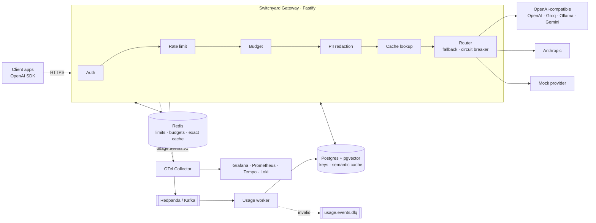

# Switchyard — Plano do Projeto (Gateway de LLM self-hosted)

> Documento mestre do projeto. Serve para você e para o Claude Code. Tudo o que for **publicado no repositório** (README, ADRs, specs, código, commits) deve ser escrito **em inglês**. Este plano fica em português só como guia pessoal (pode ficar fora do repo ou em `docs/pt-br/`).

**Nome de trabalho:** `Switchyard`. Pátio de manobras ferroviário, onde trens são roteados para o trilho certo. Antes de publicar, confira se o nome está livre no GitHub e no npm. Alternativas: `Tollbooth`, `Railyard`, `Waypoint`.

---

## 1. Visão geral

### 1.1 O que é
Um **gateway de LLM self-hosted** que fica entre as aplicações e os provedores de modelos (OpenAI, Anthropic, Gemini, Groq, Ollama…). As aplicações continuam usando o SDK oficial da OpenAI e apenas trocam a `baseURL`. O gateway então:

- **roteia** cada requisição para o modelo/provedor certo, com fallback automático;
- **controla** acesso, rate limit e orçamento por time/chave;
- **economiza** com cache exato e semântico;
- **protege** dados sensíveis (PII) antes de saírem para o provedor;
- **mede** tudo: custo, tokens, latência, TTFB, taxa de cache, erros.

### 1.2 Por que esse projeto (ligação com o mercado)
| O que as vagas pedem | Onde aparece no Switchyard |
|---|---|
| TypeScript/Node sênior, performance | Proxy Fastify com streaming SSE e overhead medido em ms |
| PostgreSQL, Redis | Persistência, rate limit, budgets e cache |
| Mensageria / event-driven | Pipeline de eventos de uso via Kafka (Redpanda), consumidor idempotente + DLQ |
| Observabilidade (OpenTelemetry) | Traces, métricas e logs ponta a ponta + dashboards Grafana versionados |
| Docker, CI/CD, IaC | Docker Compose, GitHub Actions, Terraform |
| AI Engineer: custo/latência, guardrails, multi-provider | Roteamento por custo, cache semântico, redação de PII, fallback |
| Tech Lead: design docs, trade-offs | ADRs + SDD (spec-driven development) em todo o repositório |
| Uso de ferramentas de IA (Claude Code) | Repositório construído com um *harness* explícito para Claude Code (`CLAUDE.md`, comandos) |

### 1.3 Objetivos (mensuráveis)
1. **Compatibilidade:** os SDKs oficiais OpenAI (Node e Python) funcionam apontando para o gateway, com e sem streaming (teste de contrato no CI).
2. **Overhead baixo:** p95 do overhead do gateway < **15 ms** (medido com provedor mock, sem cache). *Meta, a confirmar com k6.*
3. **Resiliência:** com o provedor primário falhando 30% das vezes, ≥ **99%** das requisições ainda têm sucesso via fallback.
4. **Economia:** cache semântico reduz custo em X% num dataset de replay, com perda de qualidade medida (número publicado no README).
5. **Operável:** um único `docker compose up` sobe tudo, incluindo Grafana com dashboards prontos.
6. **Documentado:** cada feature tem spec; cada decisão relevante tem ADR.

### 1.4 Fora do escopo (non-goals)
- Treinar ou hospedar modelos (o Ollama faz isso; o gateway só consome).
- UI web completa no MVP (o Grafana é o "dashboard"; uma UI admin é opcional na fase final).
- Multi-região / alta disponibilidade real (documentar como faria, em ADR, sem implementar).
- Billing com cobrança real.

---

## 2. Tecnologias

| Camada | Escolha | Motivo (vira ADR) |
|---|---|---|
| Runtime | **Node.js 24 LTS** | LTS atual; `fetch`/streams nativos |
| Linguagem | **TypeScript** (strict) | 15/17 vagas pedem |
| HTTP | **Fastify 5** | Performance, hooks, schemas, plugins |
| HTTP upstream | **undici** | Pool de conexões, streaming eficiente |
| Validação | **Zod** | Validação de config e payloads + tipos inferidos |
| Banco | **PostgreSQL 17 + pgvector** | Fonte da verdade + busca vetorial do cache semântico |
| ORM / migrations | **Drizzle ORM + drizzle-kit** | SQL explícito, tipado, leve |
| Cache / contadores | **Redis** (ou Valkey) | Rate limit (Lua), budgets, cache exato |
| Mensageria | **Redpanda** (API Kafka) local; cliente `@confluentinc/kafka-javascript` | Kafka é o que as vagas citam; Redpanda é leve para rodar local |
| Observabilidade | **OpenTelemetry SDK** → **grafana/otel-lgtm** (Collector + Prometheus + Tempo + Loki + Grafana) | Um container só no dev |
| Logs | **pino** (JSON, correlacionado com trace id) | Padrão Fastify |
| Testes | **Vitest**, **Testcontainers**, SDKs oficiais OpenAI para contrato | Unit + integração real + contrato |
| Carga | **k6** | Benchmarks publicados |
| Lint/format | **Biome** | Rápido, um só tool |
| Pacotes | **pnpm** | Rápido, workspaces se precisar |
| Infra | **Docker Compose**, **Terraform** (Oracle Cloud Always Free; alternativa: GCP Cloud Run + Neon + Upstash) | Grátis |
| CI | **GitHub Actions** (+ CodeQL, Dependabot) | Grátis em repo público |
| Modelos (dev, grátis) | **Ollama** (ex.: `llama3.2`, `qwen2.5`, `nomic-embed-text`), planos grátis Gemini/Groq/OpenRouter | Custo zero |

---

## 3. Funcionalidades (detalhadas)

### 3.1 API compatível com OpenAI
- `POST /v1/chat/completions`: com e sem `stream: true` (SSE).
- `POST /v1/embeddings`
- `GET /v1/models`: lista aliases e modelos permitidos para a chave.
- Erros no **formato OpenAI** (`{ error: { message, type, code } }`).
- Headers de resposta: `x-switchyard-request-id`, `x-switchyard-provider`, `x-switchyard-model`, `x-switchyard-cache: hit|miss|semantic-hit`, `x-switchyard-cost-usd`.
- **Fase posterior:** `POST /v1/messages` compatível com a Anthropic.

### 3.2 Adaptadores de provedor
- Formato **canônico interno** (request/response/chunk) + adaptadores:
  - `openai-compatible`: cobre OpenAI, Groq, OpenRouter, Ollama, Gemini (endpoint compatível).
  - `anthropic`: tradução de mensagens, system prompt, tool calls e stream de eventos.
  - `mock`: latência, erros e tokens configuráveis. Essencial para testes e benchmarks.
- Contagem de tokens: usar o `usage` retornado pelo provedor; no streaming, pedir `stream_options.include_usage` quando suportado e, se não houver, estimar (marcar `estimated: true`).

### 3.3 Chaves virtuais e autenticação
- Chaves no formato `sk-sy-<random 32 bytes base62>`, exibidas **uma única vez** e armazenadas como **hash SHA-256 + pepper** (chaves de alta entropia dispensam bcrypt).
- Cada chave pertence a um **time** e tem: modelos permitidos, limites de rate, orçamento, status (ativa/revogada), expiração opcional.
- Admin API protegida por `ADMIN_TOKEN` (MVP); depois, escopos.

### 3.4 Rate limiting
- Por chave e por time: **RPM** (requisições/min) e **TPM** (tokens/min).
- Algoritmo: **token bucket** ou **sliding window** em **script Lua atômico** no Redis.
- TPM: reserva uma estimativa antes (tokens de entrada + `max_tokens`) e **reconcilia** depois com o uso real.
- Resposta `429` + headers `x-ratelimit-limit-requests`, `x-ratelimit-remaining-requests`, `x-ratelimit-reset-requests` (e equivalentes para tokens), como a OpenAI.

### 3.5 Orçamentos (budgets)
- Orçamento mensal em USD por chave e por time, com **limite soft** (alerta / métrica) e **hard** (bloqueia).
- Contador "quente" no Redis (`INCRBYFLOAT`) para decisão em tempo real; Postgres como fonte da verdade; **job de reconciliação** corrige divergências.
- Tabela de preços por modelo em `config/pricing.yaml` (preço por 1M tokens de entrada/saída/cache), versionada. Preços reais devem ser consultados na documentação dos provedores.

### 3.6 Roteamento, fallback e resiliência
- **Aliases** em config: `fast`, `smart`, `cheap`, `local` → lista ordenada de candidatos (`provider/model`).
- Estratégias: `priority` (fallback em ordem), `lowest-cost`, `lowest-latency` (EWMA de latência por candidato).
- **Retry** com backoff exponencial + jitter em 429/5xx/timeouts; respeita `Retry-After`.
- **Nunca** re-tentar depois que o primeiro byte do stream já foi enviado ao cliente (documentar em ADR).
- **Circuit breaker** por candidato (closed → open → half-open), exposto em métrica e em `/admin/providers/health`.
- Timeouts separados: conexão, TTFB e total.

### 3.7 Cache
- **Cache exato:** chave = hash do (time, modelo resolvido, mensagens normalizadas, parâmetros relevantes). Só para `temperature == 0` ou quando o cliente pede (`x-switchyard-cache: force`). TTL configurável. Redis.
- **Cache semântico:** embedding do prompt (Ollama `nomic-embed-text` por padrão) em **pgvector**; hit se similaridade ≥ limiar (ex.: 0.95) **dentro do mesmo time + modelo + "shape" de parâmetros**. Opt-in por chave.
- Respostas de cache também podem ser servidas como stream (re-chunk), para o cliente não perceber diferença.
- Métricas: hit rate por tipo e **USD economizado**.
- Riscos documentados em ADR: vazamento entre tenants (mitigado pelo escopo), respostas erradas por similaridade (mitigado pelo limiar + evals).

### 3.8 Redação de PII (guardrail)
- Detectores: **CPF e CNPJ (com dígito verificador)**, e-mail, telefone (BR/E.164), cartão de crédito (**Luhn**), IP, e opcional "palavras proibidas".
- Modos por chave: `off | mask | block`.
- **Diferencial:** modo `mask` reversível. O gateway troca `123.456.789-09` por `<CPF_1>` antes de enviar e **restaura** o valor original na resposta (inclusive em streaming, com buffer de borda de token).
- Métrica de detecções por tipo; nunca logar o valor original.

### 3.9 Pipeline de eventos de uso
- Toda requisição gera um `UsageEvent`: `id (UUIDv7)`, time, chave, modelo pedido, modelo servido, provedor, tokens in/out/cached, custo, latência total, TTFB, status, cache, tentativas, flags de PII.
- O gateway publica no tópico Kafka `usage.events.v1` (buffer em memória limitado + flush; se o broker cair, aplica backpressure/descarte **contado em métrica**; documentar o trade-off em ADR).
- **Worker** consumidor: insere em `usage_events` de forma **idempotente** (`ON CONFLICT (id) DO NOTHING`), agrega `usage_daily`, envia mensagens inválidas para `usage.events.dlq`.
- Prompts e respostas **não** são persistidos por padrão (privacidade). Logging de conteúdo é opt-in e sempre redigido.

### 3.10 Admin API
- `POST/GET/PATCH/DELETE /admin/teams`
- `POST /admin/keys` (retorna a chave uma vez), `GET /admin/keys`, `PATCH /admin/keys/:id`, `POST /admin/keys/:id/revoke`
- `GET /admin/usage?from&to&groupBy=team|key|model|provider|day`
- `GET /admin/providers/health`
- OpenAPI gerado a partir dos schemas, servido em `/docs`.

### 3.11 Operação
- `GET /healthz` (vivo), `GET /readyz` (Postgres, Redis e Kafka ok), `GET /metrics` (se não usar só OTLP).
- Config de provedores/rotas em `config/switchyard.yaml`, validada com Zod no boot e com **hot reload** (SIGHUP ou watch).
- Graceful shutdown: para de aceitar conexões, termina streams em andamento (com limite), faz flush dos eventos.

---

## 4. Arquitetura

### 4.1 Diagrama


### 4.2 Pipeline de uma requisição
1. `onRequest`: gera request id e span raiz.
2. **Auth**: resolve a chave (cache em memória LRU de ~30 s + Redis/Postgres).
3. **Rate limit** (RPM + reserva de TPM).
4. **Budget** check.
5. **PII** redaction (se habilitado).
6. **Cache** lookup (exato → semântico).
7. **Router** escolhe o candidato → adapter → provedor (retry/fallback/circuit breaker).
8. Stream ou resposta → **PII restore** → cliente.
9. `onResponse`: reconcilia TPM e budget, grava cache, publica `UsageEvent`, fecha spans e registra métricas.

### 4.3 Estrutura de pastas (proposta)
```
switchyard/
├─ src/
│  ├─ server.ts              # bootstrap HTTP
│  ├─ worker.ts              # bootstrap do consumidor de uso
│  ├─ app.ts                 # build do Fastify (testável)
│  ├─ config/                # schema Zod, loader, hot reload
│  ├─ core/                  # tipos canônicos, erros, ports (interfaces)
│  ├─ modules/
│  │  ├─ auth/  ratelimit/  budget/  pii/  cache/
│  │  ├─ routing/            # aliases, estratégias, circuit breaker, retry
│  │  ├─ providers/          # openai-compatible, anthropic, mock
│  │  ├─ proxy/              # rotas /v1/*
│  │  ├─ usage/              # producer + consumer
│  │  └─ admin/              # rotas /admin/*
│  └─ infra/                 # db (drizzle), redis, kafka, telemetry, logger
├─ test/ (unit, integration, contract, fixtures)
├─ bench/ (k6 scripts + resultados)
├─ config/ (switchyard.example.yaml, pricing.yaml)
├─ deploy/ (docker-compose.yml, grafana/dashboards, terraform/)
├─ docs/ (architecture.md, adr/, specs/, threat-model.md, benchmarks.md)
├─ .claude/commands/ (harness SDD)
├─ CLAUDE.md
└─ README.md
```
Regra de dependência: `modules` dependem de `core` (ports); `infra` implementa ports; nada em `core` importa `infra` (arquitetura hexagonal leve).

### 4.4 Modelo de dados (inicial)
- `teams` (id, name, monthly_budget_usd, soft_limit_pct, created_at)
- `api_keys` (id, team_id, name, key_hash, key_prefix, allowed_models[], rpm, tpm, monthly_budget_usd, pii_mode, semantic_cache_enabled, status, expires_at, last_used_at, created_at)
- `usage_events` (id uuid pk, ts, team_id, key_id, requested_model, served_model, provider, input_tokens, output_tokens, cached_tokens, cost_usd numeric, latency_ms, ttfb_ms, status_code, cache_status, attempts, estimated bool)
- `usage_daily` (day, team_id, key_id, model, requests, input_tokens, output_tokens, cost_usd, pk composta)
- `semantic_cache_entries` (id, team_id, model, params_hash, embedding vector(768), response jsonb, created_at, expires_at, hits) + índice HNSW

### 4.5 Métricas principais
`switchyard_requests_total{model,provider,status,cache}` · `switchyard_request_duration_seconds` · `switchyard_ttfb_seconds` · `switchyard_gateway_overhead_seconds` · `switchyard_tokens_total{direction}` · `switchyard_cost_usd_total` · `switchyard_cache_savings_usd_total` · `switchyard_ratelimit_rejections_total` · `switchyard_budget_rejections_total` · `switchyard_circuit_state{candidate}` · `switchyard_usage_events_dropped_total` · `switchyard_pii_detections_total{type}`

---

## 5. Harness de desenvolvimento: ADR + SDD com Claude Code

### 5.1 Ideia
**Nada é implementado sem spec aprovada, e nenhuma decisão relevante fica sem ADR.** O Claude Code trabalha em ciclos curtos, guiado por arquivos do repositório, e não pela memória da conversa.

### 5.2 Artefatos
| Artefato | Onde | Conteúdo |
|---|---|---|
| **ADR** | `docs/adr/NNNN-title.md` | Formato MADR: contexto, opções, decisão, consequências. Status: Proposed / Accepted / Superseded |
| **Spec** | `docs/specs/NNN-feature/spec.md` | Problema, user stories, **critérios de aceite no formato EARS** com IDs (`AC-1`…), non-goals, perguntas em aberto |
| **Design** | `docs/specs/NNN-feature/design.md` | Componentes, contratos/API, dados, diagrama de sequência, ADRs relacionados, riscos |
| **Tasks** | `docs/specs/NNN-feature/tasks.md` | Checklist de tarefas pequenas (≤ ~2 h), cada uma ligada a ACs e com o teste que prova |
| **CLAUDE.md** | raiz | Regras do jogo para o Claude Code |
| **Comandos** | `.claude/commands/` | `/spec`, `/design`, `/tasks`, `/implement`, `/adr`, `/verify` |

**EARS** (Easy Approach to Requirements Syntax), exemplos:
- `WHEN a request arrives without a valid API key, THE gateway SHALL respond 401 in OpenAI error format.`
- `WHILE a provider circuit is open, THE router SHALL skip that candidate.`
- `IF the primary candidate returns 5xx before the first byte, THEN THE router SHALL try the next candidate.`

### 5.3 Fluxo de trabalho por feature
```
/spec 005 rate-limiting      → Claude escreve spec.md     → você revisa e aprova (Status: Approved)
/design 005                  → design.md (+ /adr se surgir decisão) → você aprova
/tasks 005                   → tasks.md
/implement 005               → executa a PRÓXIMA task: teste primeiro → código → pnpm verify → marca [x] → commit
...repete /implement até acabar
/verify 005                  → confere todos os ACs cobertos por testes, atualiza README/docs
```
Branch por spec (`feat/005-rate-limiting`), PR por spec com checklist de ACs e CI verde.

### 5.4 Quality gates (`pnpm verify`)
`biome check` + `tsc --noEmit` + `vitest run --coverage` (meta ≥ 80% em `core` e `modules`) + build. No CI, também testes de integração (Testcontainers), testes de contrato com o SDK OpenAI, CodeQL e build da imagem Docker.

### 5.5 Convenções
- Conventional Commits com o id da spec: `feat(ratelimit): add TPM reservation [spec-005]`.
- Tudo em inglês no repo.
- Sem segredos no repo; `.env.example` documentado.

---

## 6. ADRs iniciais (escrever na Fase 0)

| # | Título | Decisão proposta |
|---|---|---|
| 0001 | Record architecture decisions | Usar ADRs (MADR) + SDD |
| 0002 | Node.js + TypeScript + Fastify | Performance + ecossistema; alternativa NestJS descartada por overhead/abstração em um proxy |
| 0003 | OpenAI-compatible API as the public surface | Adoção zero-fricção via SDKs existentes |
| 0004 | Canonical internal format + provider adapters | Evitar acoplamento N×M |
| 0005 | Postgres + pgvector for state and semantic cache | Um banco a menos; pgvector suficiente na escala-alvo |
| 0006 | Redis for rate limiting and budget counters (Lua) | Atomicidade e baixa latência |
| 0007 | Kafka (Redpanda) for usage events, idempotent consumer + DLQ | Desacoplar caminho quente da escrita analítica |
| 0008 | No retries after first streamed byte | Evita respostas duplicadas/corrompidas |
| 0009 | Semantic cache scoped by team + model + params | Segurança entre tenants |
| 0010 | Do not persist prompts by default | Privacidade/LGPD/GDPR |
| 0011 | OpenTelemetry as the single telemetry API | Vendor-neutral |
| 0012 | Deploy on Oracle Cloud Always Free via Terraform | Custo zero, VM ARM generosa |

---

## 7. Roadmap (≈ 8 semanas em meio período)

| Semana | Specs | Entregável |
|---|---|---|
| 1 | **000** harness (CLAUDE.md, comandos, ADR 0001–0004), **001** bootstrap | Repo com CI, Compose (Postgres, Redis, Redpanda, LGTM, Ollama), `/healthz`, README esqueleto |
| 2 | **002** provider adapters + chat proxy (não-stream), **003** streaming SSE | SDK OpenAI funcionando contra Ollama e mock; testes de contrato |
| 3 | **004** virtual keys + admin API, **005** rate limiting | Chaves, times, 429 com headers |
| 4 | **006** usage events pipeline, **007** budgets | Kafka + worker idempotente + DLQ; bloqueio por orçamento |
| 5 | **008** routing, fallback, retry, circuit breaker | Aliases, failover provado por teste de caos |
| 6 | **009** exact + semantic cache, **010** PII redaction | Economia mensurável; CPF mascarado e restaurado |
| 7 | **011** observability (dashboards), **012** k6 benchmarks | Dashboards versionados; tabela de benchmarks no README |
| 8 | **013** Terraform deploy, **014** Anthropic `/v1/messages` (opcional), polish | Demo pública com limites, post técnico em inglês |

**Marcos de divulgação:** fim da semana 2 (primeiro post: "building an LLM gateway in Node"), semana 7 (benchmarks), semana 8 (lançamento).

---

## 8. Testes

- **Unit:** roteamento, circuit breaker, cálculo de custo, detectores de PII (CPF/CNPJ/Luhn), normalização de cache, tradução de adapters.
- **Integração (Testcontainers):** Postgres, Redis, Redpanda reais; Lua de rate limit; consumidor idempotente (mesmo evento 2× = 1 linha).
- **Contrato:** SDK oficial OpenAI (Node e Python) contra o gateway, com stream e sem stream, tool calls e erros.
- **Caos:** mock com 30% de 5xx / timeouts / latência alta → valida fallback e o objetivo 3.
- **Carga (k6):** cenários `no-cache`, `exact-cache`, `streaming`, `rate-limited`; resultados em `bench/results/` e `docs/benchmarks.md` com hardware descrito.

## 9. Segurança
- Chaves com hash, prefixo visível só para identificação, comparação em tempo constante.
- Limites de tamanho de body, timeouts, headers de segurança.
- Sem conteúdo de prompt em logs/traces por padrão (atributos de span sanitizados).
- `docs/threat-model.md` (STRIDE): vazamento cross-tenant no cache, abuso de chave, exaustão de orçamento, injeção via config.
- Dependabot, CodeQL, `pnpm audit` no CI.

## 10. README (o cartão de visitas)
O `README.md` em inglês deve ter: tagline, badges (CI, license, Node), GIF/demo, "Why", features, diagrama Mermaid, quickstart em 3 comandos, exemplo com o SDK OpenAI (Node e Python), configuração, **tabela de benchmarks com números reais** (nunca inventados), observabilidade (screenshot do Grafana), docs (ADRs/specs), roadmap, contribuição e licença (MIT). Já existe um rascunho em `README.md`; os números entram só depois de medidos.

## 11. Custo
R$ 0 seguindo: Ollama para desenvolvimento e evals, Docker Compose local, GitHub Actions público, Oracle Always Free para a demo. Demo pública com modelo pago só com orçamento hard configurado no próprio gateway e limite de gasto no painel do provedor.

## 12. Como começar com o Claude Code
1. Crie o repositório `switchyard` (público) e copie para ele: `README.md`, `CLAUDE.md`, `.claude/`, `docs/`.
2. Abra o Claude Code na pasta e peça: *"Read CLAUDE.md and docs/specs/001-bootstrap/spec.md. Run /design 001."*
3. Revise o design e aprove; depois `/tasks 001` e `/implement 001` repetidamente.
4. Ao final de cada spec: PR, CI verde, merge, e atualize o roadmap do README.

## 13. Evoluções futuras (depois do MVP)
- Plataforma de **evals** (projeto 2) plugada no gateway para medir a qualidade do cache semântico e do roteamento.
- **Servidor MCP** expondo uso e custos para o Claude/Cursor consultarem.
- Roteamento inteligente por classificador de complexidade do prompt.
- UI admin em Next.js.
