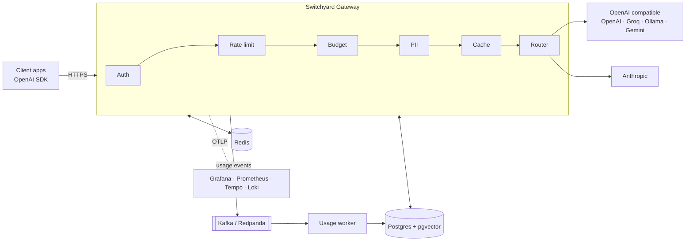

<div align="center">

# 🚦 Switchyard

**A self-hosted, OpenAI-compatible LLM gateway: routing, fallbacks, budgets, caching and PII redaction, with full observability.**

Point your existing OpenAI SDK at Switchyard. Get control over cost, reliability and data, without changing your app.

[](https://github.com/OWNER/switchyard/actions/workflows/ci.yml)


[](LICENSE)

[Quickstart](#-quickstart) · [Features](#-features) · [Architecture](#-architecture) · [Benchmarks](#-benchmarks) · [Docs](#-documentation) · [Roadmap](#-roadmap)

</div>

---

## Why

Teams that ship LLM features quickly run into the same problems:

- 💸 **Costs nobody can explain.** Which team, key or feature spent what?
- 🔥 **Provider outages and 429s** take the product down with them.
- 🔐 **Sensitive data** (emails, card numbers, national IDs) leaks into third-party prompts.
- 🧩 **Every provider has a different API**, so switching models means rewriting code.

Switchyard sits between your apps and model providers and handles all of this in one place.

## ✨ Features

| | |
|---|---|
| 🔌 **Drop-in OpenAI API** | `/v1/chat/completions` (incl. SSE streaming), `/v1/embeddings`, `/v1/models`. Works with the official SDKs. |
| 🧭 **Smart routing** | Model aliases (`fast`, `smart`, `cheap`), priority / lowest-cost / lowest-latency strategies. |
| 🛟 **Resilience** | Retries with jittered backoff, automatic fallback, per-provider circuit breakers. |
| 🔑 **Virtual keys & teams** | Scoped keys with allowed models, hashed at rest, revocable. |
| 🚥 **Rate limiting** | Requests/min and tokens/min per key and team (atomic Redis Lua). |
| 💰 **Budgets** | Monthly USD budgets with soft alerts and hard limits. |
| ⚡ **Caching** | Exact cache (Redis) and semantic cache (pgvector), tenant-scoped. |
| 🛡️ **PII redaction** | Detects emails, phones, cards (Luhn), CPF/CNPJ; mask reversibly, or block. |
| 📊 **Observability** | OpenTelemetry traces, metrics and logs with ready-made Grafana dashboards. |
| 📨 **Usage pipeline** | Usage events through Kafka (Redpanda) to an idempotent worker with a DLQ. |

**Providers:** OpenAI · Anthropic · Google Gemini · Groq · OpenRouter · Ollama (local) · Mock

## 🚀 Quickstart

```bash
git clone https://github.com/OWNER/switchyard && cd switchyard
cp .env.example .env
docker compose up -d        # gateway, worker, Postgres, Redis, Redpanda, Grafana, Ollama
```

Create a key:

```bash
curl -s localhost:8080/admin/keys \
  -H "Authorization: Bearer $ADMIN_TOKEN" \
  -d '{"team":"demo","name":"my-app","allowedModels":["fast","local"]}'
# → { "key": "sk-sy-…" }   (shown only once)
```

Use it with the **official OpenAI SDK**. Only the `baseURL` changes:

```ts
import OpenAI from "openai";

const client = new OpenAI({ baseURL: "http://localhost:8080/v1", apiKey: process.env.SWITCHYARD_KEY });

const stream = await client.chat.completions.create({
  model: "fast",                       // an alias: routed + fallback handled by Switchyard
  messages: [{ role: "user", content: "Explain circuit breakers in one paragraph." }],
  stream: true,
});
for await (const chunk of stream) process.stdout.write(chunk.choices[0]?.delta?.content ?? "");
```

```python
from openai import OpenAI
client = OpenAI(base_url="http://localhost:8080/v1", api_key="sk-sy-...")
print(client.chat.completions.create(model="local", messages=[{"role": "user", "content": "Hi!"}]).choices[0].message.content)
```

Open Grafana at **http://localhost:3000** to watch cost, latency and cache hits live.

## 🏗 Architecture



Every request flows through a pipeline of small, testable stages. See [`docs/architecture.md`](docs/architecture.md) and the [ADRs](docs/adr) for the reasoning behind each decision.

## ⚙️ Configuration

Routes and providers live in a single validated YAML file (hot-reloaded):

```yaml
providers:
  ollama:  { type: openai-compatible, baseUrl: http://ollama:11434/v1 }
  groq:    { type: openai-compatible, baseUrl: https://api.groq.com/openai/v1, apiKeyEnv: GROQ_API_KEY }
  claude:  { type: anthropic, apiKeyEnv: ANTHROPIC_API_KEY }

aliases:
  fast:
    strategy: priority
    candidates: [groq/llama-3.1-8b-instant, ollama/llama3.2]
  smart:
    strategy: lowest-latency
    candidates: [claude/claude-sonnet, groq/llama-3.3-70b-versatile]
```

## 📈 Benchmarks

> Measured with [k6](bench/) against a mock provider to isolate gateway overhead. Hardware and method: [`docs/benchmarks.md`](docs/benchmarks.md).

| Scenario | RPS | Overhead p50 | Overhead p95 | Overhead p99 |
|---|---|---|---|---|
| Proxy, no cache | _TBD_ | _TBD_ | _TBD_ | _TBD_ |
| Exact cache hit | _TBD_ | _TBD_ | _TBD_ | _TBD_ |
| Streaming (TTFB) | _TBD_ | _TBD_ | _TBD_ | _TBD_ |

| Resilience test | Result |
|---|---|
| Primary provider failing 30% of requests | _TBD_ % success via fallback |
| Semantic cache on replay dataset | _TBD_ % cost saved |

## 🧪 Quality

- Unit tests (Vitest), integration tests on real Postgres/Redis/Redpanda (Testcontainers)
- **Contract tests with the official OpenAI SDKs** (Node + Python), streaming included
- Chaos tests (injected 5xx, timeouts, latency) and k6 load tests in CI
- Strict TypeScript, Biome, CodeQL, Dependabot

## 📚 Documentation

- [Architecture](docs/architecture.md)
- [Architecture Decision Records](docs/adr)
- [Feature specs](docs/specs) (each feature is spec'd with EARS acceptance criteria before it's built)
- [Threat model](docs/threat-model.md)
- [Benchmarks](docs/benchmarks.md)

> 🤖 This project is built with a **spec-driven workflow with Claude Code**: specs → design → tasks → test-first implementation. See [`CLAUDE.md`](CLAUDE.md).

## 🗺 Roadmap

- [ ] OpenAI-compatible proxy + streaming
- [ ] Virtual keys, teams, rate limiting
- [ ] Usage pipeline (Kafka) + budgets
- [ ] Routing, fallback, circuit breakers
- [ ] Exact + semantic cache
- [ ] PII redaction (reversible masking)
- [ ] Grafana dashboards + published benchmarks
- [ ] Terraform deploy (Oracle Cloud Always Free)
- [ ] Anthropic-compatible `/v1/messages`

## 🤝 Contributing

Issues and PRs are welcome. Start with an issue, and for larger changes a spec in `docs/specs/`.

## 📄 License

[MIT](LICENSE)
